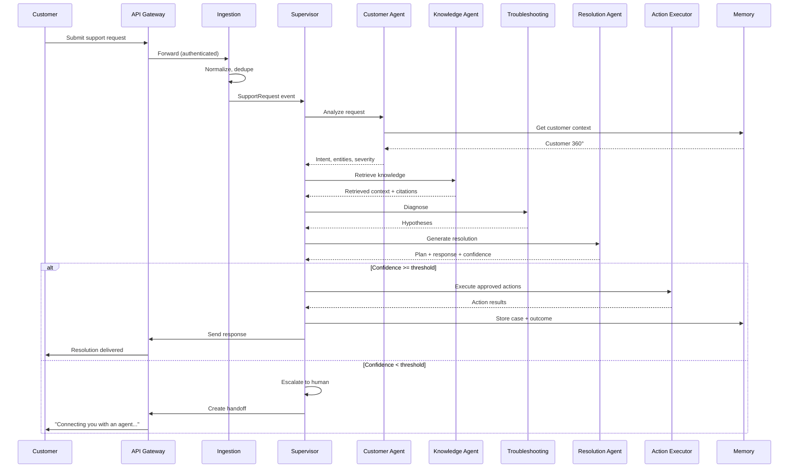
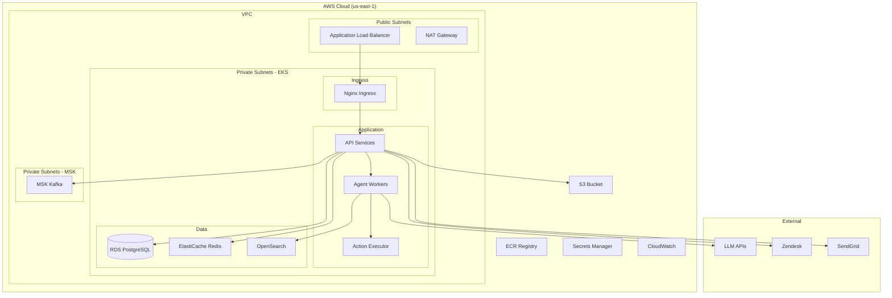

# High-Level Design (HLD)

## Autonomous Customer Support & Resolution Platform

**Version:** 1.0  
**Date:** 2026-11-26  
**Status:** Draft  
**Document Owner:** Architecture Team  
**Classification:** Internal - Confidential

---

## Table of Contents

1. [Architecture Overview](#1-architecture-overview)
2. [Architectural Principles](#2-architectural-principles)
3. [System Context](#3-system-context)
4. [Container Architecture](#4-container-architecture)
5. [Component Architecture](#5-component-architecture)
6. [Agent Architecture](#6-agent-architecture)
7. [Data Architecture](#7-data-architecture)
8. [Integration Architecture](#8-integration-architecture)
9. [Deployment Architecture](#9-deployment-architecture)
10. [Security Architecture](#10-security-architecture)
11. [Observability Architecture](#11-observability-architecture)
12. [Multi-Cloud Strategy](#12-multi-cloud-strategy)
13. [Technology Stack](#13-technology-stack)
14. [Architecture Decision Records](#14-architecture-decision-records)
15. [Appendix: Architecture Diagrams](#15-appendix-architecture-diagrams)

---

## 1. Architecture Overview

### 1.1 Purpose
This document defines the high-level architecture for the Autonomous Customer Support & Resolution Platform. It translates the business requirements (PRD/BRD) into a technical blueprint covering system structure, component interactions, data flows, deployment topology, and cross-cutting concerns.

### 1.2 Architecture Style
The platform follows a **Event-Driven, Multi-Agent, Cloud-Native Architecture** with the following key patterns:

| Pattern | Application |
|---------|-------------|
| **Event-Driven Architecture (EDA)** | Asynchronous communication via event bus; loose coupling between services |
| **Multi-Agent Orchestration** | LangGraph Supervisor pattern coordinating specialized agents |
| **CQRS** | Separate read/write models for customer context and analytics |
| **Saga Pattern** | Distributed transactions for multi-step action workflows |
| **Circuit Breaker** | Resilience against failing external integrations |
| **Sidecar Pattern** | Envoy proxies for service mesh, observability agents |
| **Strangler Fig** | Gradual migration from legacy ticketing systems |

### 1.3 Key Characteristics
- **Stateless compute** — All services horizontally scalable
- **Event-sourced actions** — Immutable audit trail, replayable workflows
- **Multi-tenant from day one** — Logical isolation, configurable data residency
- **Cloud-portable** — Abstracted infrastructure, no cloud-specific lock-in
- **Human-in-the-loop native** — Approval workflows as first-class citizens

---

## 2. Architectural Principles

| # | Principle | Description |
|---|-----------|-------------|
| P1 | **Autonomy with Guardrails** | Agents operate autonomously within defined safety boundaries; humans approve high-risk actions |
| P2 | **Context is King** | Every agent has access to full customer context; context flows seamlessly through escalation |
| P3 | **Retrieve before Generate** | Ground all responses in retrieved knowledge; no answer without evidence |
| P4 | **Everything is Observable** | Every decision, retrieval, and action is traced, logged, and analyzable |
| P5 | **Fail Safe, Not Fail Closed** | On uncertainty, escalate to human rather than guess |
| P6 | **Tenant Isolation by Default** | No data leakage; tenant context enforced at every layer |
| P7 | **Cloud-Agnostic** | Same deployment manifest across AWS, Azure, GCP |
| P8 | **API-First** | All capabilities exposed via versioned APIs; UI is just another client |
| P9 | **Continuous Learning** | Production feedback flows back to improve agents |
| P10 | **Security is Not Optional** | Encryption, RBAC, audit logging, and compliance are foundational |

---

## 3. System Context

### 3.1 Context Diagram

```
┌─────────────────────────────────────────────────────────────────────────────┐
│                              EXTERNAL ACTORS                                 │
├─────────────────────────────────────────────────────────────────────────────┤
│  Customer (Web/Chat/Email)    Agent (Dashboard)    Manager (Admin UI)        │
└──────────────────────┬───────────────┬────────────────────┬─────────────────┘
                       │               │                    │
                       ▼               ▼                    ▼
┌─────────────────────────────────────────────────────────────────────────────┐
│                    API GATEWAY / LOAD BALANCER                               │
│         (Auth, Rate Limiting, Request Routing, WAF)                          │
└──────────────────────────────────────┬──────────────────────────────────────┘
                       │
                       ▼
┌─────────────────────────────────────────────────────────────────────────────┐
│              AUTONOMOUS SUPPORT & RESOLUTION PLATFORM                        │
│                                                                              │
│  ┌──────────┐  ┌──────────┐  ┌──────────┐  ┌──────────┐  ┌──────────┐      │
│  │Ingestion │  │Orchestr- │  │  Agents  │  │ Action   │  │ Memory   │      │
│  │Services  │──│ ator     │──│ (Lang-   │──│ Executor │──│ Service  │      │
│  │          │  │          │  │  Graph)  │  │ (MCP)    │  │          │      │
│  └──────────┘  └──────────┘  └──────────┘  └──────────┘  └──────────┘      │
│       │              │              │              │              │          │
│  ┌────┴──────────────┴──────────────┴──────────────┴──────────────┴────┐    │
│  │                    EVENT BUS (Kafka/EventHub/PubSub)                 │    │
│  └────────────────────────────────────────────────────────────────────┘    │
│       │                                                                      │
│  ┌────┴──────────┬──────────────┬──────────────┬─────────────────────┐     │
│  │ PostgreSQL    │ Redis        │ Vector DB    │ Object Storage      │     │
│  │ (Transactional│ (Cache/Mem)  │ (Pinecone/   │ (S3/Blob/GCS)       │     │
│  │  + Knowledge) │              │  Weaviate)   │ (Docs, Attachments) │     │
│  └───────────────┴──────────────┴──────────────┴─────────────────────┘     │
└──────────────────────────────────────┬──────────────────────────────────────┘
                       │
                       ▼
┌─────────────────────────────────────────────────────────────────────────────┐
│                          EXTERNAL INTEGRATIONS                               │
├─────────────────────────────────────────────────────────────────────────────┤
│  Zendesk    Intercom    ServiceNow    SendGrid    Stripe    Internal APIs   │
│  (Tickets)  (Chat)      (Tickets)    (Email)    (Billing) (CRM/Product)    │
└─────────────────────────────────────────────────────────────────────────────┘
```

### 3.2 Key External Systems

| System | Integration Type | Purpose |
|--------|------------------|---------|
| **Zendesk / Intercom / ServiceNow** | REST API + Webhooks | Ticket ingestion, sync |
| **SendGrid / AWS SES / Azure Communication** | SMTP / REST | Email processing |
| **Stripe / Internal Billing** | REST API | Billing actions |
| **Product Telemetry (Segment/Mixpanel)** | Event Stream | Usage context |
| **Internal CRM (Salesforce/HubSpot)** | REST API | Customer 360° |
| **Identity Provider (Okta/Azure AD)** | SAML/OIDC | SSO, RBAC |
| **Slack / Teams** | Webhook | Agent notifications, escalation alerts |
| **PagerDuty** | REST API | Critical alert routing |

---

## 4. Container Architecture

### 4.1 Container Diagram (C4 Level 2)

```
                          ┌─────────────────────────────────────────────────┐
                          │           CLIENT APPLICATIONS                    │
                          │  ┌──────────┐ ┌──────────┐ ┌──────────────┐     │
                          │  │ Web Chat │ │ In-App   │ │ Agent Console│     │
                          │  │ Widget   │ │ Widget   │ │ (Next.js)    │     │
                          │  └──────────┘ └──────────┘ └──────────────┘     │
                          └─────────────────────────────────────────────────┘
                                              │
                                              ▼
┌─────────────────────────────────────────────────────────────────────────────┐
│                              API GATEWAY                                     │
│  (Kong/Envoy + Auth Service: OIDC, RBAC, Rate Limiting, WAF)                │
└──────────────────────────────────────┬──────────────────────────────────────┘
                                       │
        ┌──────────────────────────────┼──────────────────────────────┐
        │                              │                              │
        ▼                              ▼                              ▼
┌───────────────┐            ┌────────────────┐            ┌────────────────┐
│ Ingestion     │            │ Orchestration  │            │ Admin          │
│ Service       │            │ Service        │            │ Service        │
│ (FastAPI)     │            │ (FastAPI +     │            │ (FastAPI)      │
│               │            │  LangGraph)    │            │                │
│ - Channel     │            │ - Supervisor   │            │ - Config       │
│   Adapters    │            │ - Workflows    │            │ - RBAC         │
│ - Normalization│           │ - State Mgmt   │            │ - Analytics    │
│ - Dedup       │            │ - HITL         │            │ - Audit Log    │
└───────┬───────┘            └───────┬────────┘            └───────┬────────┘
        │                            │                             │
        │            ┌───────────────┼───────────────┐             │
        │            │               │               │             │
        │            ▼               ▼               ▼             │
        │    ┌──────────────┐ ┌──────────┐ ┌──────────────┐        │
        │    │ Agent        │ │ Action   │ │ Knowledge    │        │
        │    │ Workers      │ │ Executor │ │ Service      │        │
        │    │ (Python +    │ │ Service  │ │ (FastAPI +   │        │
        │    │  LangGraph)  │ │ (FastAPI)│ │  RAG Pipeline)│        │
        │    │              │ │          │ │              │        │
        │    │ Customer     │ │ - MCP    │ │ - Retrieval  │        │
        │    │ Troubleshoot │ │   Tools  │ │ - Reranking  │        │
        │    │ Resolution   │ │ - Approve│ │ - Citation   │        │
        │    │ Escalation   │ │ - Audit  │ │              │        │
        │    └──────────────┘ └──────────┘ └──────────────┘        │
        │                            │                             │
        │            ┌───────────────┼───────────────┐             │
        │            │               │               │             │
        ▼            ▼               ▼               ▼             ▼
┌─────────────────────────────────────────────────────────────────────────────┐
│                              DATA LAYER                                      │
│  ┌────────────┐ ┌────────────┐ ┌────────────┐ ┌────────────┐ ┌──────────┐ │
│  │ PostgreSQL │ │ Redis      │ │ Vector DB  │ │ Object     │ │ Event    │ │
│  │            │ │            │ │            │ │ Storage    │ │ Bus      │ │
│  │ - Tickets  │ │ - Cache    │ │ - Embeddings│ │ - Docs    │ │ - Kafka  │ │
│  │ - Customers│ │ - Sessions │ │ - Indexes  │ │ - Attach   │ │ - Event  │ │
│  │ - Actions  │ │ - Rate Lim │ │ - Knowledge│ │ - Exports  │ │   Hub    │ │
│  │ - Audit    │ │ - Locks    │ │            │ │            │ │ - PubSub │ │
│  └────────────┘ └────────────┘ └────────────┘ └────────────┘ └──────────┘ │
└─────────────────────────────────────────────────────────────────────────────┘
```

### 4.2 Container Responsibilities

| Container | Responsibility | Scaling |
|-----------|----------------|---------|
| **API Gateway** | Auth, rate limiting, routing, WAF, TLS termination | Horizontal, L7 LB |
| **Ingestion Service** | Multi-channel ingestion, normalization, deduplication | Horizontal, queue-driven |
| **Orchestration Service** | Agent workflow execution, state management, HITL | Horizontal, stateful sessions |
| **Agent Workers** | Individual agent execution (Customer, Knowledge, etc.) | Horizontal, per-agent-type pools |
| **Action Executor** | MCP tool execution, approval workflow, audit | Horizontal, action-type queues |
| **Knowledge Service** | RAG pipeline, vector search, reranking, indexing | Horizontal, index sharding |
| **Admin Service** | Configuration, RBAC, analytics, audit queries | Horizontal, read replicas |
| **Data Layer** | Persistence, caching, events, files | Managed services |

---

## 5. Component Architecture

### 5.1 Service Catalog

| Service | Framework | Primary Responsibility | Key Dependencies |
|---------|-----------|----------------------|------------------|
| `gateway` | Envoy + Kong | Edge routing, auth, rate limit | Redis, OIDC Provider |
| `auth-service` | FastAPI | OIDC, JWT, RBAC/ABAC, sessions | PostgreSQL, Redis |
| `ingestion-service` | FastAPI | Channel adapters, normalization | Kafka, Object Storage |
| `orchestration-service` | FastAPI + LangGraph | Workflow coordination, state | PostgreSQL, Redis, Kafka |
| `customer-agent` | Python + LangGraph | Intent, entity extraction, context | LLM API, PostgreSQL |
| `knowledge-agent` | Python + LangGraph | Retrieval, reranking, synthesis | Vector DB, LLM API |
| `troubleshooting-agent` | Python + LangGraph | Diagnosis, hypothesis | LLM API, Internal APIs |
| `resolution-agent` | Python + LangGraph | Plan generation, response | LLM API, Knowledge Agent |
| `escalation-agent` | Python + LangGraph | Context packaging, routing | PostgreSQL, Slack/Teams |
| `action-executor` | FastAPI | MCP tools, approval, audit | Internal APIs, PostgreSQL |
| `memory-service` | FastAPI | Customer memory, pattern extraction | PostgreSQL, Redis, Vector DB |
| `admin-service` | FastAPI | Config, RBAC, analytics | PostgreSQL, Redis |
| `notification-service` | FastAPI | Email, Slack, webhook delivery | SendGrid, Slack API |
| `evaluation-service` | Python | Quality metrics, A/B testing | LangSmith, PostgreSQL |

### 5.2 Service Interaction Matrix

| From → To | Gateway | Auth | Ingestion | Orchestration | Agents | Action | Knowledge | Memory | Admin |
|-----------|---------|------|-----------|---------------|--------|--------|-----------|--------|-------|
| Gateway | - | ✓ | ✓ | ✓ | - | - | - | - | ✓ |
| Auth | ✓ | - | - | - | - | - | - | - | - |
| Ingestion | - | - | - | ✓ | - | - | - | - | - |
| Orchestration | - | - | - | - | ✓ | ✓ | ✓ | ✓ | - |
| Agents | - | - | - | - | - | - | ✓ | ✓ | - |
| Action | - | - | - | - | - | - | - | - | - |
| Knowledge | - | - | - | - | ✓ | - | - | - | - |
| Memory | - | - | - | - | ✓ | - | - | - | - |
| Admin | - | - | - | - | - | - | - | ✓ | - |

### 5.3 Communication Patterns

| Pattern | Use Case | Implementation |
|---------|----------|----------------|
| **Synchronous REST** | User-facing requests, agent queries | HTTP/JSON, gRPC internal |
| **Async Events** | Ticket updates, actions, notifications | Kafka / Event Hub / PubSub |
| **Pub/Sub** | Agent broadcasts, status updates | Redis Pub/Sub, WebSocket |
| **Request/Reply** | Agent → Knowledge retrieval | gRPC with timeout/retry |
| **Saga/Orchestration** | Multi-step action workflows | LangGraph state machine |

---

## 6. Agent Architecture

### 6.1 Multi-Agent Orchestration (LangGraph)

```
┌─────────────────────────────────────────────────────────────────────────────┐
│                        SUPERVISOR AGENT                                      │
│                                                                              │
│  Responsibilities:                                                           │
│  - Decompose incoming requests into subtasks                                 │
│  - Route to appropriate specialist agents                                    │
│  - Manage shared state (conversation, context, results)                      │
│  - Detect completion / escalation conditions                                 │
│  - Coordinate human-in-the-loop approvals                                    │
│                                                                              │
│  ┌───────────────────────────────────────────────────────────────────────┐  │
│  │                         SHARED STATE                                   │  │
│  │  { conversation_id, customer_context, intent, severity,              │  │
│  │    retrieval_results, hypotheses, plan, actions, approvals }         │  │
│  └───────────────────────────────────────────────────────────────────────┘  │
└──────────────────────────────────────┬──────────────────────────────────────┘
                                       │
         ┌─────────────────────────────┼─────────────────────────────┐
         │                             │                             │
         ▼                             ▼                             ▼
┌─────────────────┐         ┌─────────────────┐         ┌─────────────────┐
│ CUSTOMER AGENT  │         │ KNOWLEDGE AGENT │         │ TROUBLESHOOTING │
│                 │         │                 │         │     AGENT       │
│ - Intent class  │         │ - Hybrid search │         │ - Diagnostics   │
│ - Entity extract│         │ - Reranking     │         │ - Hypothesis    │
│ - Sentiment     │         │ - Synthesis     │         │ - Correlation   │
│ - Context build │         │ - Citation      │         │ - Next steps    │
└─────────────────┘         └─────────────────┘         └─────────────────┘
                                       │                             │
                                       │                             │
         ┌─────────────────────────────┴─────────────────────────────┘
         │
         ▼
┌─────────────────┐         ┌─────────────────┐
│ RESOLUTION AGENT│         │ ESCALATION      │
│                 │         │ AGENT           │
│ - Plan generation│        │ - Context pack  │
│ - Response gen  │         │ - Routing       │
│ - Confidence    │         │ - SLA tracking  │
│ - HITL trigger  │         │ - Notifications │
└─────────────────┘         └─────────────────┘
```

### 6.2 Agent Responsibilities & Contracts

#### Supervisor Agent
| Aspect | Detail |
|--------|--------|
| **Input** | `SupportRequest` event from ingestion |
| **Output** | `WorkflowState` with delegated tasks |
| **Tools** | None (pure orchestration) |
| **LLM** | GPT-4o / Claude 3.5 Sonnet (routing) |
| **Memory** | Session state, cross-agent results |
| **Escalation Trigger** | Confidence < 0.6, Critical severity, policy match |

#### Customer Agent
| Aspect | Detail |
|--------|--------|
| **Input** | Raw message + conversation history |
| **Output** | `Intent`, `Entities`, `Sentiment`, `CustomerContext` |
| **Tools** | `customer_lookup`, `subscription_info`, `usage_metrics` |
| **LLM** | GPT-4o mini / Claude 3 Haiku (fast classification) |
| **Memory** | Customer profile cache (Redis, 5-min TTL) |

#### Knowledge Agent
| Aspect | Detail |
|--------|--------|
| **Input** | Intent + Entities + Query |
| **Output** | `RetrievedContext` with citations, `ConfidenceScore` |
| **Tools** | `vector_search`, `bm25_search`, `graph_query`, `rerank`, `fetch_doc` |
| **LLM** | Claude 3.5 Sonnet (synthesis) |
| **Memory** | Query cache, embedding cache |

#### Troubleshooting Agent
| Aspect | Detail |
|--------|--------|
| **Input** | Intent + Customer context + Retrieved knowledge |
| **Output** | `Hypotheses[]`, `DiagnosticSteps[]`, `RequiredInfo` |
| **Tools** | `api_health_check`, `config_validate`, `log_query`, `feature_flag_check` |
| **LLM** | GPT-4o (reasoning) |
| **Memory** | Known issues DB, incident correlation |

#### Resolution Agent
| Aspect | Detail |
|--------|--------|
| **Input** | Hypotheses + Knowledge + Customer context |
| **Output** | `ResolutionPlan`, `CustomerResponse`, `AgentNotes`, `Confidence` |
| **Tools** | `generate_response`, `validate_plan` |
| **LLM** | Claude 3.5 Sonnet (generation) |
| **Memory** | Similar case embeddings, template library |

#### Escalation Agent
| Aspect | Detail |
|--------|--------|
| **Input** | Full workflow state + escalation reason |
| **Output** | `EscalationPackage`, `RoutingDecision`, `SLATimer` |
| **Tools** | `route_to_team`, `notify_agent`, `create_ticket`, `set_sla` |
| **LLM** | GPT-4o mini (summarization) |
| **Memory** | Team skills matrix, agent availability |

### 6.3 Agent Communication Protocol

```python
# LangGraph State Schema
class WorkflowState(TypedDict):
    conversation_id: str
    tenant_id: str
    customer: CustomerContext
    request: SupportRequest
    intent: Intent
    severity: Severity
    category: Category
    retrieval: RetrievedContext
    hypotheses: list[Hypothesis]
    plan: ResolutionPlan
    actions: list[PlannedAction]
    approvals: list[Approval]
    escalations: list[Escalation]
    confidence: float
    status: Literal["processing", "awaiting_input", "awaiting_approval", "resolved", "escalated"]
    created_at: datetime
    updated_at: datetime
```

---

## 7. Data Architecture

### 7.1 Data Classification

| Classification | Examples | Storage | Retention |
|----------------|----------|---------|-----------|
| **Customer PII** | Name, email, phone, address | PostgreSQL (encrypted) | 7 years (configurable) |
| **Conversation Data** | Messages, attachments | PostgreSQL + Object Storage | 2 years (configurable) |
| **Action Audit** | Who, what, when, result | PostgreSQL (immutable) | 7 years |
| **Knowledge Corpus** | Docs, tickets, runbooks | Vector DB + Object Storage | Per source |
| **Embeddings** | Document/ticket vectors | Vector DB | With source |
| **Analytics** | Aggregated metrics | PostgreSQL + Redis | 3 years |
| **System Logs** | Application logs, traces | OpenSearch / Log Analytics | 90 days |
| **Cache** | Sessions, lookups | Redis | TTL-based |

### 7.2 Data Stores

| Store | Technology (Abstracted) | Purpose | Backup |
|-------|-------------------------|---------|--------|
| **Transactional DB** | PostgreSQL 16 | Tickets, customers, actions, config, audit | PITR, daily snapshots, cross-region |
| **Cache/Session** | Redis 7 | Session state, rate limits, hot data, pub/sub | AOF + RDB, replica |
| **Vector DB** | Pinecone / Weaviate / Qdrant | Knowledge embeddings, case similarity | Index rebuild from source, snapshots |
| **Object Storage** | S3 / Blob / GCS | Documents, attachments, exports | Versioned, lifecycle policies |
| **Event Bus** | Kafka / Event Hub / PubSub | Async communication, event sourcing | Retention 7 days, replication 3x |
| **Search** | OpenSearch / Azure AI Search | Full-text search, analytics queries | Snapshot daily |

### 7.3 Data Flow

```
┌─────────────┐    ┌─────────────┐    ┌─────────────�┐    ┌─────────────┐
│   Incoming  │───▶│  Ingestion  │───▶│ Normalization│───▶│   Event Bus │
│   Request   │    │   Service   │    │   Service    │    │  (Kafka)    │
└─────────────┘    └─────────────┘    └─────────────┘    └──────┬──────┘
                                                                │
                     ┌──────────────────────────────────────────┘
                     │
                     ▼
              ┌─────────────┐
              │Orchestration│◀──── Configuration ────┐
              │   Service   │                        │
              └──────┬──────┘                        │
                     │                               │
         ┌───────────┼───────────┐                   │
         ▼           ▼           ▼                   │
    ┌────────┐ ┌────────┐ ┌────────┐        ┌────────┴────────┐
    │ Agents │ │Action  │ │Memory  │        │  Admin Service  │
    │        │ │Executor│ │Service │        │  (Config CRUD)  │
    └────────┘ └───┬────┘ └────────┘        └─────────────────┘
                   │
                   ▼
            ┌─────────────┐
            │   Audit     │────▶ Immutable Audit Log (PostgreSQL)
            │   Logger    │      + Object Storage (JSON exports)
            └─────────────┘
```

### 7.4 Multi-Tenancy Strategy

| Layer | Isolation Strategy |
|-------|-------------------|
| **API** | Tenant ID in JWT claim, enforced at gateway |
| **Database** | Row-level security (RLS), `tenant_id` column indexed |
| **Cache** | Key prefix `{tenant_id}:` |
| **Vector DB** | Namespace/partition per tenant |
| **Object Storage** | Prefix `tenants/{tenant_id}/` |
| **Events** | Tenant ID in event envelope, filtered by consumers |
| **Search** | Index per tenant or filtered queries |

---

## 8. Integration Architecture

### 8.1 Integration Patterns

| Pattern | Use Case | Technology |
|---------|----------|------------|
| **API Gateway** | Single entry point, auth, rate limit | Kong / Envoy |
| **Webhook Receiver** | Inbound events from external systems | FastAPI endpoints, signature verification |
| **Polling Adapter** | Systems without webhook support | Scheduled jobs (Celery/Temporal) |
| **Event Stream** | Real-time data sync | Kafka connectors |
| **MCP (Model Context Protocol)** | Agent tool calling | MCP server registry |

### 8.2 External Integrations Catalog

| Integration | Direction | Protocol | Auth | Frequency |
|-------------|-----------|----------|------|-----------|
| **Zendesk** | Bidirectional | REST + Webhook | API Token | Real-time |
| **Intercom** | Bidirectional | REST + Webhook | Bearer Token | Real-time |
| **ServiceNow** | Bidirectional | REST + Webhook | OAuth 2.0 | Real-time |
| **SendGrid/SES** | Bidirectional | SMTP / REST | API Key | Real-time |
| **Stripe** | Outbound | REST | API Key | On-demand |
| **Salesforce/CRM** | Inbound | REST | OAuth 2.0 | On-demand |
| **Segment/Mixpanel** | Inbound | Event Stream | API Key | Real-time |
| **Slack/Teams** | Outbound | Webhook / REST | Bot Token | Event-driven |
| **PagerDuty** | Outbound | REST | API Key | Event-driven |
| **Okta/Azure AD** | Inbound | OIDC/SAML | Client Secret | Auth-time |

### 8.3 Internal APIs (MCP Tools)

| Tool Name | Category | Risk Level | Approval Required |
|-----------|----------|------------|-------------------|
| `customer.lookup` | Read | Low | No |
| `subscription.get` | Read | Low | No |
| `subscription.change` | Write | Medium | Yes (> tier change) |
| `billing.refund` | Write | High | Yes (always) |
| `billing.invoice.get` | Read | Low | No |
| `account.password_reset` | Write | Medium | No (with verification) |
| `account.update_profile` | Write | Low | No (limited fields) |
| `feature_flag.toggle` | Write | High | Yes |
| `config.get` | Read | Low | No |
| `config.update` | Write | High | Yes |
| `ticket.create` | Write | Low | No |
| `ticket.update` | Write | Low | No |
| `notification.send` | Write | Low | No |
| `log.query` | Read | Medium | No (scoped) |
| `api.health_check` | Read | Low | No |

---

## 9. Deployment Architecture

### 9.1 Environment Topology

```
┌─────────────────────────────────────────────────────────────────────────────┐
│                              DEVELOPMENT                                     │
│  - Local Docker Compose                                                      │
│  - Single-tenant, mock integrations                                         │
│  - Ephemeral data, seed scripts                                              │
└─────────────────────────────────────────────────────────────────────────────┘
                                      │
                                      ▼
┌─────────────────────────────────────────────────────────────────────────────┐
│                               STAGING                                        │
│  - Cloud (same as prod, smaller)                                             │
│  - Real integrations (sandbox mode)                                         │
│  - Synthetic data + anonymized prod samples                                  │
│  - E2E tests, load tests, security scans                                    │
└─────────────────────────────────────────────────────────────────────────────┘
                                      │
                                      ▼
┌─────────────────────────────────────────────────────────────────────────────┐
│                              PRODUCTION                                      │
│  ┌─────────────────────────────────────────────────────────────────────┐    │
│  │                         REGION: US-EAST                             │    │
│  │  ┌──────────┐  ┌──────────┐  ┌──────────┐  ┌──────────┐            │    │
│  │  │   AZ-1   │  │   AZ-2   │  │   AZ-3   │  │  DR      │            │    │
│  │  │          │  │          │  │          │  │ (Cross-  │            │    │
│  │  │ API GW   │  │ API GW   │  │ API GW   │  │  Region) │            │    │
│  │  │ Services │  │ Services │  │ Services │  │          │            │    │
│  │  │ Workers  │  │ Workers  │  │ Workers  │  │ Standby  │            │    │
│  │  └──────────┘  └──────────┘  └──────────┘  └──────────┘            │    │
│  └─────────────────────────────────────────────────────────────────────┘    │
│                                                                              │
│  ┌─────────────────────────────────────────────────────────────────────┐    │
│  │                    REGION: EU-WEST (Data Residency)                  │    │
│  │  (Same topology, tenant data segregated by region)                  │    │
│  └─────────────────────────────────────────────────────────────────────┘    │
└─────────────────────────────────────────────────────────────────────────────┘
```

### 9.2 Kubernetes Architecture

```yaml
# Namespace Structure
namespaces:
  - platform-system      # Istio, cert-manager, monitoring
  - auth                 # Auth service, OIDC proxy
  - ingestion            # Channel adapters
  - orchestration        # LangGraph workflows
  - agents               # Agent workers (separate deployments per agent)
  - actions              # Action executor, approval service
  - knowledge            # RAG service, indexer
  - memory               # Memory service
  - admin                # Admin API, dashboard BFF
  - data                 # PostgreSQL operator, Redis operator, Vector DB
  - observability        # OTel collector, Prometheus, Grafana, Loki
```

### 9.3 Scaling Strategy

| Component | Scaling Metric | Min | Max | Strategy |
|-----------|----------------|-----|-----|----------|
| API Gateway | RPS | 3 | 50 | HPA (CPU 70%) |
| Ingestion | Queue depth | 2 | 30 | KEDA (Kafka lag) |
| Orchestration | Active workflows | 3 | 40 | HPA (custom metric) |
| Agent Workers | Queue per agent | 2 | 20 each | KEDA (queue depth) |
| Action Executor | Approval queue | 2 | 10 | HPA (CPU + queue) |
| Knowledge Service | QPS | 3 | 30 | HPA (latency + CPU) |
| PostgreSQL | Connections | 2 (HA) | Read replicas | Vertical + replicas |
| Redis | Memory | 3 (cluster) | 10 shards | Cluster mode |

---

## 10. Security Architecture

### 10.1 Defense in Depth

```
┌─────────────────────────────────────────────────────────────────────────────┐
│ LAYER 1: EDGE                                                               │
│ - WAF (OWASP rules, custom)                                                 │
│ - DDoS protection                                                           │
│ - TLS 1.3 termination                                                       │
│ - Rate limiting (IP, user, tenant)                                          │
│ - Bot detection                                                             │
└──────────────────────────────────────┬──────────────────────────────────────┘
                                       │
┌──────────────────────────────────────┴──────────────────────────────────────┐
│ LAYER 2: AUTHENTICATION & AUTHORIZATION                                   │
│ - OIDC/SAML SSO                                                             │
│ - JWT with short TTL (15 min), refresh tokens                               │
│ - MFA for admin roles                                                       │
│ - RBAC + ABAC (tenant, role, resource)                                      │
│ - Service-to-service: mTLS (Istio)                                          │
└──────────────────────────────────────┬──────────────────────────────────────┘
                                       │
┌──────────────────────────────────────┴──────────────────────────────────────┐
│ LAYER 3: APPLICATION                                                        │
│ - Input validation (Pydantic)                                               │
│ - Output encoding                                                           │
│ - CSRF protection                                                           │
│ - SQL injection prevention (ORM)                                            │
│ - SSRF protection (egress filtering)                                        │
│ - Dependency scanning (SCA)                                                 │
└──────────────────────────────────────┬──────────────────────────────────────┘
                                       │
┌──────────────────────────────────────┴──────────────────────────────────────┐
│ LAYER 4: DATA                                                               │
│ - Encryption at rest (AES-256)                                              │
│ - Encryption in transit (TLS 1.3)                                           │
│ - Field-level encryption for PII                                            │
│ - Tokenization for sensitive data                                           │
│ - Database RLS for tenant isolation                                         │
│ - Immutable audit logs                                                      │
└──────────────────────────────────────┬──────────────────────────────────────┘
                                       │
┌──────────────────────────────────────┴──────────────────────────────────────┐
│ LAYER 5: INFRASTRUCTURE                                                     │
│ - Private subnets, no public IPs for data tier                              │
│ - Security groups / NSGs / Firewall rules                                   │
│ - Secrets management (Vault / Key Vault / Secret Manager)                   │
│ - Image scanning, signed images                                             │
│ - Runtime security (Falco)                                                  │
│ - Network policies (Kubernetes)                                             │
└─────────────────────────────────────────────────────────────────────────────┘
```

### 10.2 Compliance Mapping

| Requirement | Implementation |
|-------------|----------------|
| **GDPR** | Data residency (EU region), right to erasure API, DPA templates, consent tracking |
| **CCPA** | Data disclosure API, opt-out of sale, deletion workflows |
| **SOC 2** | Audit logging, access reviews, change management, incident response |
| **HIPAA** | BAA with cloud providers, encryption, access controls, audit (optional module) |
| **PCI DSS** | Tokenization, no card data storage, Stripe integration (SAQ-A) |

---

## 11. Observability Architecture

### 11.1 Observability Stack

| Signal | Tool | Collection | Storage | Visualization |
|--------|------|------------|---------|---------------|
| **Traces** | OpenTelemetry + LangSmith | SDK auto-instrumentation | LangSmith + Tempo/Jaeger | LangSmith UI, Grafana |
| **Metrics** | Prometheus + OpenTelemetry | Sidecar/SDK export | Prometheus + Thanos/Mimir | Grafana |
| **Logs** | Structured JSON (stdout) | Fluent Bit / OTel Collector | Loki / Azure Monitor / CloudWatch | Grafana, Kibana |
| **Business Metrics** | Custom OTel metrics | SDK export | Prometheus | Grafana dashboards |
| **Agent Quality** | LangSmith evaluations | Eval runs | LangSmith | LangSmith dashboard |

### 11.2 Key Dashboards

| Dashboard | Audience | Key Metrics |
|-----------|----------|-------------|
| **Operations Overview** | SRE, On-call | Uptime, Latency P50/P95/P99, Error rate, Saturation |
| **Business KPIs** | Leadership, PM | ARR, MTTR, CSAT, Escalation rate, Cost/ticket |
| **Agent Quality** | ML Team | Retrieval precision, Classification accuracy, Hallucination rate |
| **Tenant Health** | Customer Success | Per-tenant volume, resolution rate, SLA compliance |
| **Security** | Security Team | Failed auth, Rate limit hits, WAF blocks, Anomalies |
| **Cost** | FinOps | Token usage, Compute cost, Storage cost, Cost per resolution |

### 11.3 Alerting Strategy

| Severity | Examples | Routing | Response Time |
|----------|----------|---------|---------------|
| **Critical (P0)** | Service down, Data breach, Action failure > 1% | PagerDuty → On-call | 5 min |
| **High (P1)** | Latency > 2x SLO, Error rate > 5% | PagerDuty → Secondary | 15 min |
| **Medium (P2)** | Queue depth > threshold, Disk > 80% | Slack → Team channel | 1 hour |
| **Low (P3)** | Certificate expiry, Deprecation warnings | Email digest | 24 hours |

---

## 12. Multi-Cloud Strategy

### 12.1 Abstraction Layers

| Layer | Abstraction | AWS | Azure | GCP |
|-------|-------------|-----|-------|-----|
| **Compute** | Kubernetes (EKS/AKS/GKE) | EKS | AKS | GKE |
| **Container Registry** | OCI Registry | ECR | ACR | Artifact Registry |
| **PostgreSQL** | Cloud SQL compatible | RDS | Azure Database | Cloud SQL |
| **Redis** | Redis protocol | ElastiCache | Azure Cache | Memorystore |
| **Object Storage** | S3-compatible API | S3 | Blob Storage | Cloud Storage |
| **Event Bus** | Kafka protocol | MSK | Event Hubs (Kafka) | PubSub (via connector) |
| **Secrets** | Vault / External Secrets | Secrets Manager + Vault | Key Vault + Vault | Secret Manager + Vault |
| **CDN** | Standard HTTP | CloudFront | Front Door | Cloud CDN |
| **DNS** | Standard DNS | Route 53 | Azure DNS | Cloud DNS |
| **IaC** | Terraform | ✓ | ✓ | ✓ |
| **CI/CD** | GitHub Actions / GitLab CI | ✓ | ✓ | ✓ |

### 12.2 Deployment Portability

```hcl
# Terraform module structure (cloud-agnostic)
module "platform" {
  source = "github.com/org/terraform-modules/platform"

  cloud_provider = var.cloud_provider  # "aws" | "azure" | "gcp"
  region         = var.region
  environment    = var.environment

  # Common configuration (provider-agnostic)
  kubernetes_version = "1.29"
  node_pools = {
    system = { min = 3, max = 5, instance = "standard-4" }
    agents = { min = 2, max = 20, instance = "standard-8" }
    data   = { min = 3, max = 3, instance = "memory-optimized-8" }
  }
}
```

### 12.3 Cloud-Specific Services (Optional Optimizations)

| Capability | AWS Native | Azure Native | GCP Native |
|------------|------------|--------------|------------|
| **LLM Gateway** | Bedrock | Azure OpenAI | Vertex AI |
| **Vector Search** | OpenSearch k-NN | Azure AI Search | Vertex AI Search |
| **Speech** | Transcribe/Polly | Speech Service | Speech-to-Text |
| **Translation** | Translate | Translator | Translation API |

---

## 13. Technology Stack

### 13.1 Core Stack

| Layer | Technology | Version | Rationale |
|-------|------------|---------|-----------|
| **Frontend** | Next.js 14 (App Router) | 14.x | SSR, SEO, React ecosystem |
| **UI Components** | shadcn/ui + Tailwind CSS | Latest | Accessible, customizable |
| **State Management** | Zustand + TanStack Query | Latest | Lightweight, server-state focus |
| **Backend API** | FastAPI | 0.110+ | Async, type-safe, auto-docs |
| **Agent Framework** | LangGraph | 0.2+ | Stateful multi-agent, HITL |
| **LLM Gateway** | LiteLLM / Custom | Latest | Multi-provider, routing, caching |
| **Primary LLM** | Claude 3.5 Sonnet / GPT-4o | Latest | Quality reasoning + generation |
| **Fast LLM** | Claude 3 Haiku / GPT-4o mini | Latest | Classification, extraction |
| **Embedding** | text-embedding-3-large / Cohere | Latest | Semantic search |
| **Reranker** | Cohere Rerank / BGE | Latest | Precision improvement |
| **Database** | PostgreSQL | 16 | ACID, JSONB, RLS, extensions |
| **Cache** | Redis | 7 | Speed, pub/sub, locks |
| **Vector DB** | Weaviate / Qdrant / Pinecone | Latest | Hybrid search, filtering |
| **Event Bus** | Kafka (MSK/Confluent) | 3.6+ | Throughput, durability |
| **Object Storage** | S3 / Blob / GCS | - | Files, artifacts |
| **Search** | OpenSearch | 2.x | Full-text, analytics |
| **Orchestration** | Kubernetes | 1.29+ | Container orchestration |
| **Service Mesh** | Istio | 1.20+ | mTLS, traffic, observability |
| **API Gateway** | Kong / Envoy Gateway | Latest | Routing, plugins |
| **Auth** | Keycloak / Auth0 / Custom | Latest | OIDC, RBAC |
| **IaC** | Terraform | 1.7+ | Multi-cloud provisioning |
| **CI/CD** | GitHub Actions / GitLab CI | - | Build, test, deploy |
| **Observability** | OTel + Grafana + Loki + Tempo | Latest | Open standard |
| **Agent Tracing** | LangSmith | Latest | Agent-specific debugging |
| **Secrets** | HashiCorp Vault | 1.15+ | Dynamic secrets, rotation |

### 13.2 Data & ML

| Component | Technology | Purpose |
|-----------|------------|---------|
| **ETL/ELT** | Airflow / Dagster | Data pipelines |
| **Feature Store** | Feast (optional) | ML features |
| **Model Registry** | MLflow | Model versioning |
| **Evaluation** | LangSmith + Custom | Quality metrics |
| **Vector Indexing** | HNSW (built-in) | Similarity search |
| **Embedding Pipeline** | Custom + Unstructured | Document chunking |

---

## 14. Architecture Decision Records

### ADR-001: LangGraph for Agent Orchestration
**Status:** Accepted  
**Context:** Need multi-agent coordination with state management, human-in-the-loop, and observability.  
**Decision:** Use LangGraph as the agent orchestration framework.  
**Consequences:** (+) Built-in HITL, state persistence, streaming; (–) Relatively new, smaller community.

### ADR-002: Event-Driven Architecture
**Status:** Accepted  
**Context:** Multiple services need loose coupling, async processing, audit trail.  
**Decision:** Adopt event-driven architecture with Kafka as the event backbone.  
**Consequences:** (+) Scalability, resilience, audit; (–) Eventual consistency complexity.

### ADR-003: PostgreSQL as Primary Store
**Status:** Accepted  
**Context:** Need ACID transactions, JSON flexibility, row-level security for multi-tenancy.  
**Decision:** PostgreSQL 16 as primary transactional database.  
**Consequences:** (+) Mature, extensible, RLS; (–) Vertical scaling limits (mitigated by read replicas).

### ADR-004: Multi-Cloud from Day One
**Status:** Accepted  
**Context:** Enterprise customers require cloud flexibility; avoid lock-in.  
**Decision:** Cloud-agnostic architecture with Terraform, Kubernetes, managed services abstracted.  
**Consequences:** (+) Portability, customer choice; (–) Cannot use cloud-specific optimizations by default.

### ADR-005: Hybrid Retrieval (Vector + Keyword + Graph)
**Status:** Accepted  
**Context:** Pure vector search misses exact matches; keyword misses semantics.  
**Decision:** Combine vector (semantic), BM25 (keyword), and graph (relationships) retrieval.  
**Consequences:** (+) Higher recall + precision; (–) More complex pipeline, higher latency.

### ADR-006: Human-in-the-Loop for All Write Actions
**Status:** Accepted  
**Context:** Autonomous actions carry risk; need safety guardrail.  
**Decision:** All write actions above risk threshold require human approval.  
**Consequences:** (+) Safety, compliance; (–) Adds latency for complex actions.

---

## 15. Appendix: Architecture Diagrams

### A. Sequence Diagram: Autonomous Resolution



### B. Deployment Diagram (AWS Example)



---

**Document Control**
| Version | Date | Author | Changes |
|---------|------|--------|---------|
| 1.0 | 2026-11-26 | Architecture Team | Initial draft |

**Reviewers:**
- [ ] Engineering Lead
- [ ] DevOps Lead
- [ ] Security Architect
- [ ] ML Lead

---

*End of HLD Document*