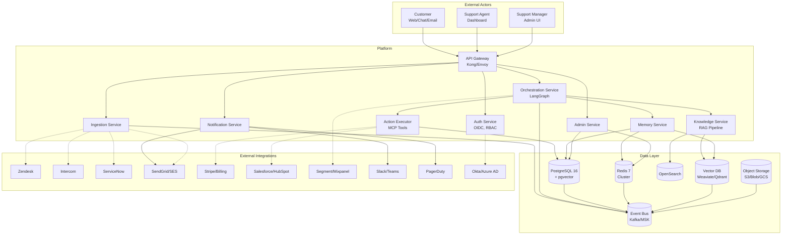
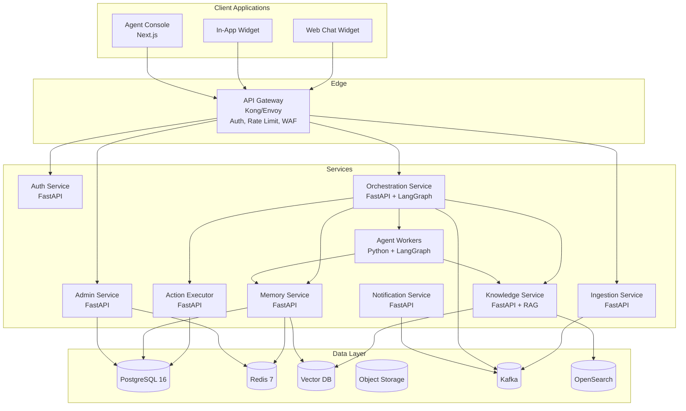
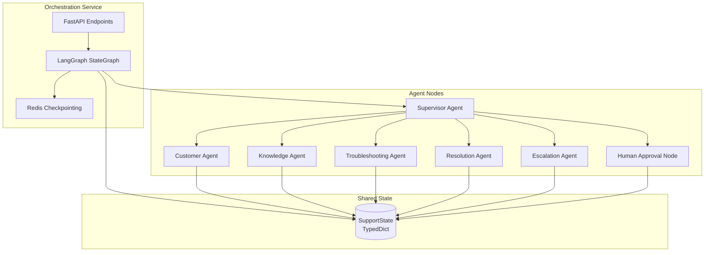
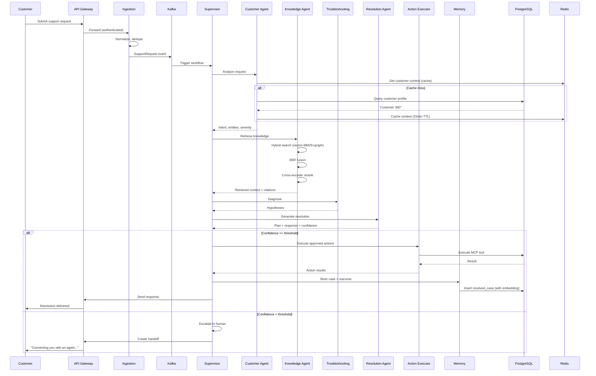
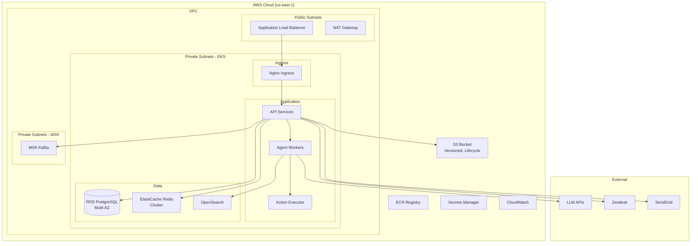
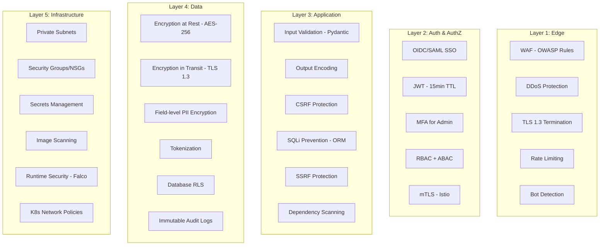

# ARCHITECTURE.md - Component and Infrastructure Diagrams

## System Context Diagram



## Container Diagram (C4 Level 2)



## Component Diagram - Orchestration Service



## Data Flow Diagram



## Deployment Architecture (AWS Example)



## Kubernetes Namespace Layout

```yaml
# Namespace Structure
namespaces:
  - platform-system    # Istio, cert-manager, monitoring
  - auth               # Auth service, OIDC proxy
  - ingestion          # Channel adapters
  - orchestration      # LangGraph workflows
  - agents             # Agent workers (separate deployments per agent)
  - actions            # Action executor, approval service
  - knowledge          # RAG service, indexer
  - memory             # Memory service
  - admin              # Admin API, dashboard BFF
  - data               # PostgreSQL operator, Redis operator, Vector DB
  - observability      # OTel collector, Prometheus, Grafana, Loki
```

## Multi-Cloud Service Mapping

| Component | AWS | Azure | GCP |
|-----------|-----|-------|-----|
| Kubernetes | EKS | AKS | GKE |
| Container Registry | ECR | ACR | Artifact Registry |
| PostgreSQL | RDS | Azure Database | Cloud SQL |
| Redis | ElastiCache | Azure Cache | Memorystore |
| Vector DB | Pinecone/OpenSearch | Azure AI Search | Vertex AI Vector Search |
| Event Bus | MSK | Event Hubs (Kafka) | Pub/Sub |
| Object Storage | S3 | Blob Storage | Cloud Storage |
| Secrets | Secrets Manager | Key Vault | Secret Manager |
| CDN | CloudFront | Front Door | Cloud CDN |
| DNS | Route 53 | Azure DNS | Cloud DNS |
| IaC | Terraform | Terraform | Terraform |
| CI/CD | GitHub Actions | GitHub Actions | GitHub Actions |

## Security Layers



## Agent Communication Protocol

```mermaid
graph LR
    subgraph "LangGraph State (SupportState)"
        State[{
            ticket_id,
            tenant_id,
            messages[],
            customer{},
            intent,
            category,
            severity,
            sentiment,
            retrieved_docs[],
            hypotheses[],
            proposed_actions[],
            draft_response,
            confidence,
            is_escalated,
            next_node
        }]
    end

    Supervisor -->|Routes| Customer
    Supervisor -->|Routes| Knowledge
    Supervisor -->|Routes| Troubleshooting
    Supervisor -->|Routes| Resolution
    Supervisor -->|Routes| Escalation
    Supervisor -->|Routes| HumanApproval

    Customer -->|Writes: intent, entities, severity, customer| State
    Knowledge -->|Writes: retrieved_docs| State
    Troubleshooting -->|Writes: hypotheses| State
    Resolution -->|Writes: proposed_actions, draft_response, confidence| State
    Escalation -->|Writes: escalation_package| State
    HumanApproval -->|Writes: approval_result| State
```

---

*Diagrams are in Mermaid format. Render with any Mermaid-compatible viewer (GitHub, GitLab, VS Code, Notion, Obsidian).*